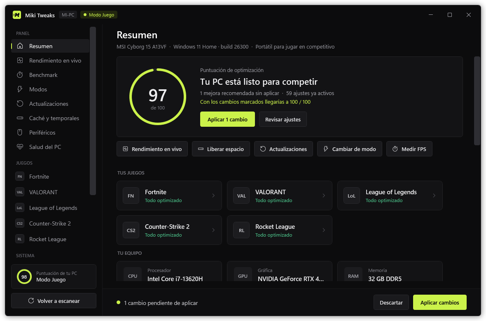
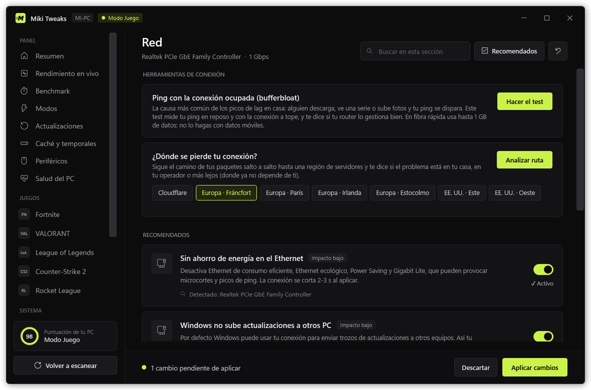
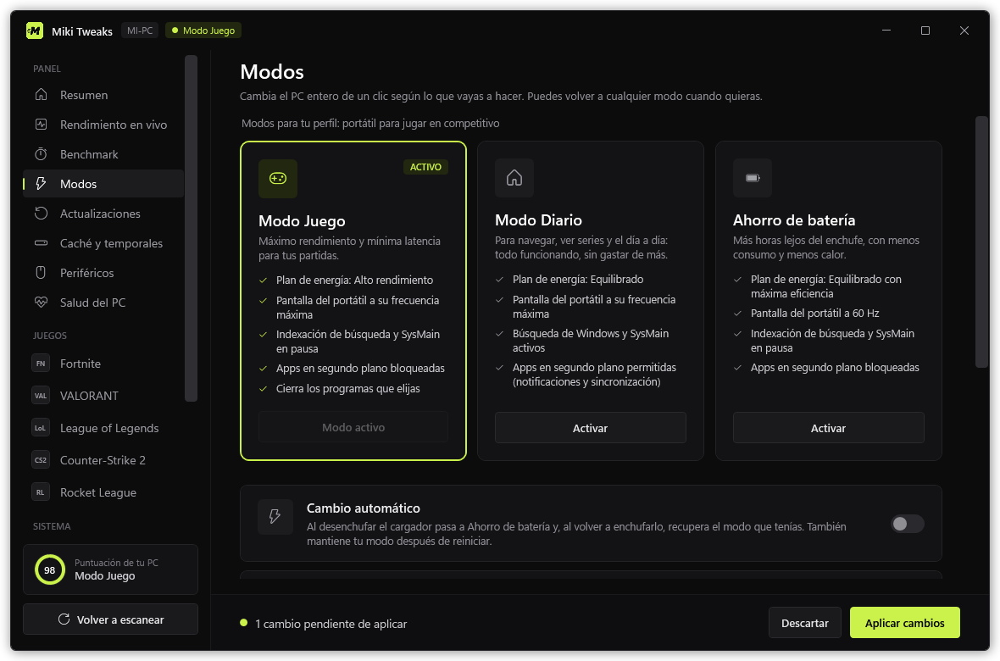
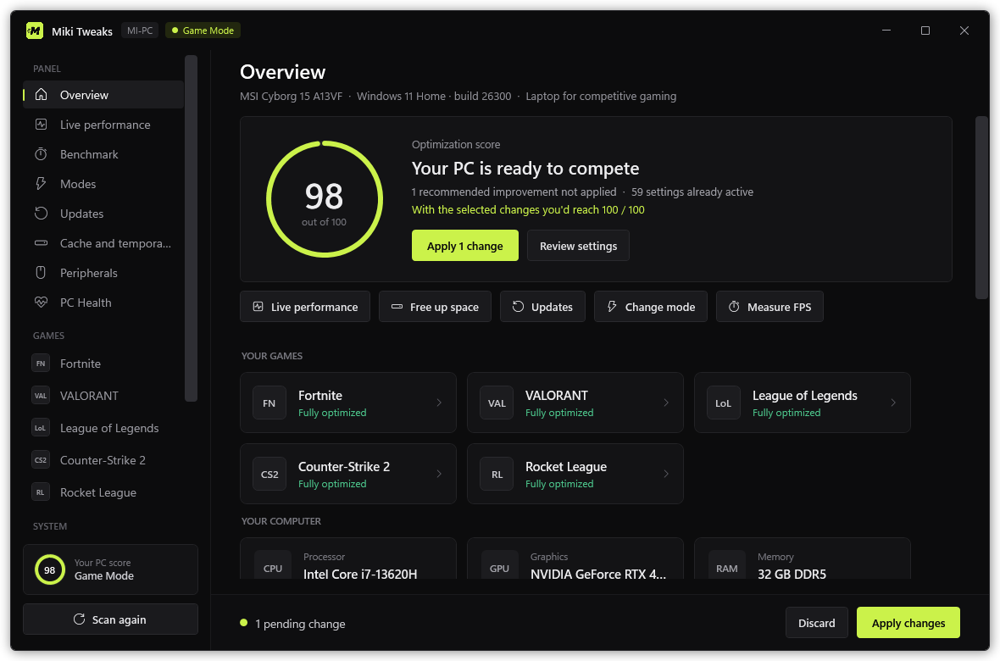

<h1 align="center">Miki Tweaks</h1>

<b>Optimiza tu PC para jugar en competitivo.</b> Escanea tu hardware, tu Windows y tus juegos, y propone solo los ajustes que tienen sentido en tu equipo. Todo se puede deshacer.

<a href="../../releases/latest"><b>⬇ Descargar la última versión</b></a> · <a href="#english">English</a>

## Qué hace

- **Ajustes con sentido para tu PC:** de Windows, de la red y de cada juego (Fortnite, VALORANT, League of Legends, CS2, Apex, Rainbow Six Siege, Overwatch 2, Rocket League, Marvel Rivals, Dota 2 y PUBG). Si un ajuste no aplica a tu equipo, no aparece.
- **Benchmark de FPS y latencia** con PresentMon de Intel: mide antes y después y comparte el resultado como imagen.
- **Herramientas de red:** test de bufferbloat (por qué sube tu ping cuando alguien descarga) y análisis de la ruta hasta los servidores (si el problema está en tu casa, en tu operador o más lejos).
- **Modos de un clic:** Juego, Diario, Batería... El Modo Juego se activa solo al abrir un juego y pausa las descargas de Windows mientras juegas.
- **Diagnóstico y salud del PC:** drivers, Windows Update, RAM en doble canal, discos, batería, cable de red que va más lento de lo que debería...
- **Limpieza:** programas de inicio, apps preinstaladas, temporales y cachés.
- **Español e inglés**, Windows 10 y Windows 11.

## Seguridad

- Antes de aplicar crea un **punto de restauración**, guarda una **copia de cada ajuste** y todo se puede **deshacer** (uno a uno, por tandas o todo a la vez).
- **No toca** tus archivos, Riot Vanguard, Medal, tus planes de energía, Xbox, Microsoft Store, Defender ni Windows Update.
- No modifica los archivos de los juegos (salvo su configuración oficial) ni se mete en sus procesos.
- **Sin promesas de FPS:** la mejora depende de cada PC. Mídela tú mismo con el Benchmark.

## Instalación

1. Descarga el ZIP de la [última versión](../../releases/latest).
2. Clic derecho en el ZIP → **Propiedades** → marca **Desbloquear** → Aceptar. Después, **Extraer todo**.
3. Abre **«Abrir Miki Tweaks.cmd»** y acepta el aviso de administrador.
4. Si aparece «Windows protegió tu PC», pulsa **Más información → Ejecutar de todas formas**. Sale porque la app todavía no está firmada digitalmente.

La primera vez se instala sola y crea su acceso directo. Requisitos: Windows 10 (22H2) u 11 y PowerShell 5.1 (viene con Windows).

## Capturas

| Herramientas de red | Modos |
| --- | --- |
|  |  |

## Licencia

[MIT](LICENSE): puedes usarla, modificarla y compartirla citando el origen. Se ofrece tal cual, sin garantías.

---

## English

**Optimize your PC for competitive gaming.** Miki Tweaks scans your hardware, Windows and games, and suggests only the settings that make sense on your computer. Everything can be undone.

- Game, network and Windows settings tailored to your PC, for 11 competitive games.
- FPS and latency benchmark (Intel PresentMon), with before/after comparison and a shareable result image.
- Network tools: bufferbloat test and route analysis (home, ISP or beyond).
- One-click modes, automatic Game Mode and paused downloads while you play.
- Diagnostics, PC health and cleanup. Spanish and English. Windows 10 and 11.

**Safety:** restore point before applying, a backup of every setting, and everything can be undone. It never touches your files, anti-cheats or game files (other than their official settings). No FPS promises: measure it yourself.

**Install:** download the ZIP from the [latest release](../../releases/latest), right-click → Properties → Unblock, extract it and run **«Abrir Miki Tweaks.cmd»**. If SmartScreen appears, click *More info → Run anyway* (the app isn't code-signed yet).

